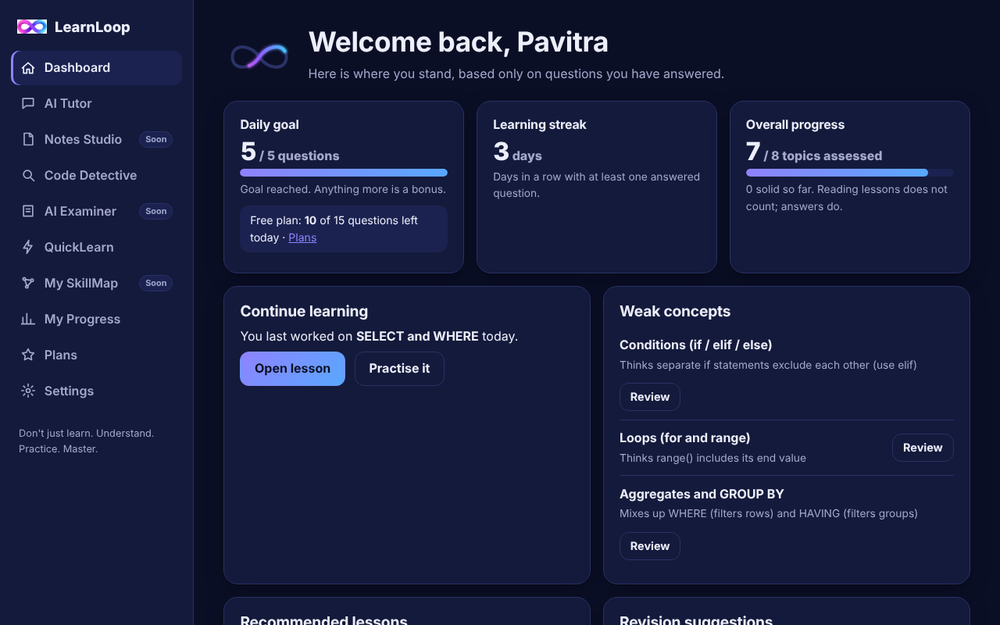
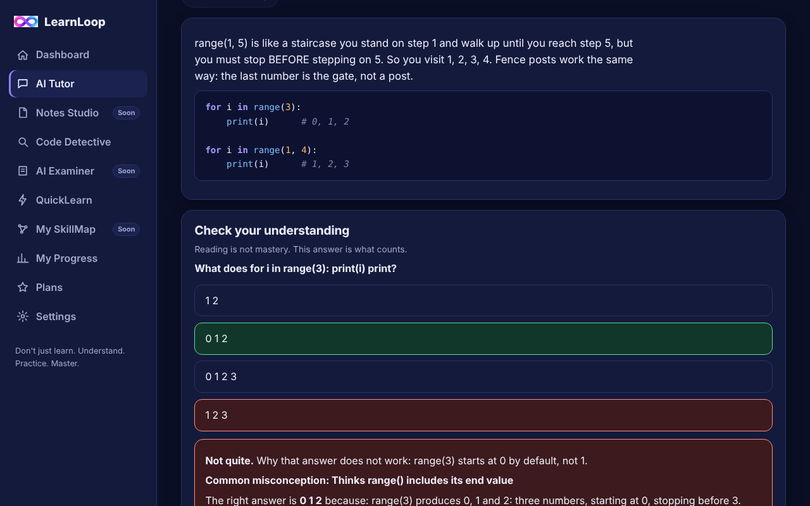
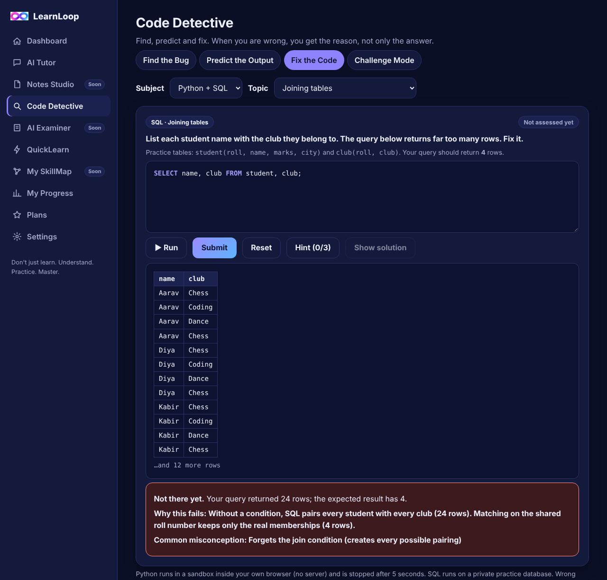
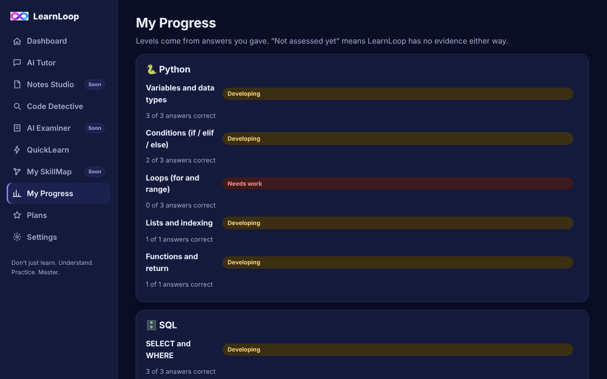
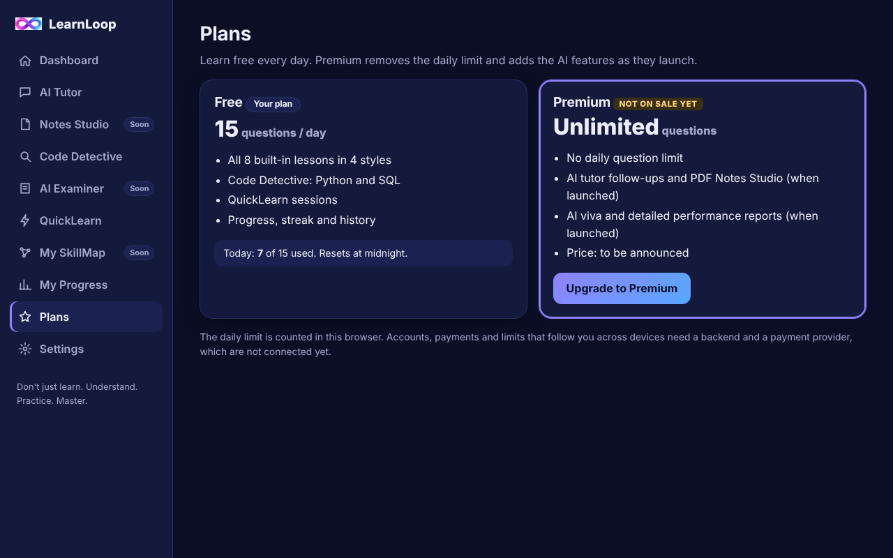
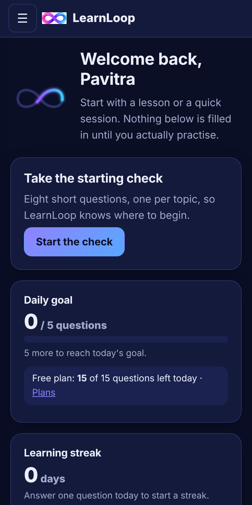
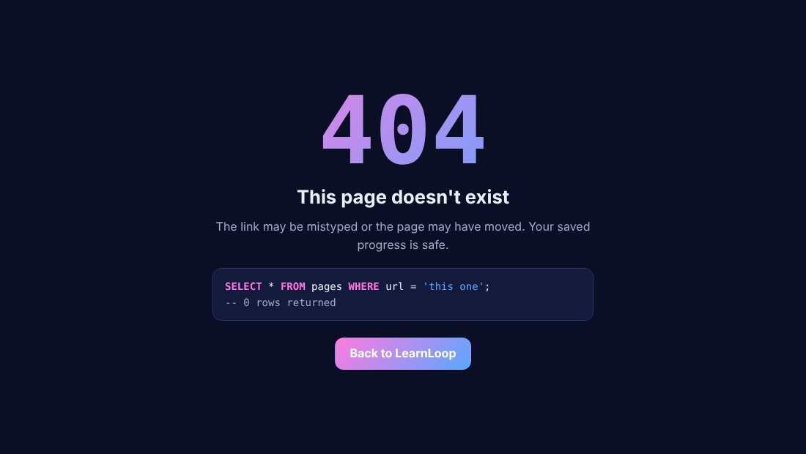

# LearnLoop

**Don't just learn. Understand. Practice. Master.**

A learning app for CS and IT students that explains *why* an answer is wrong, remembers each misunderstanding and brings it back until it is fixed.

## What makes it different
Most practice apps show the correct answer and move on. LearnLoop shows the reason: every wrong option has its own explanation, and the mistake is named and tracked.

## Features
- **Dashboard** with daily goal, streak, weak concepts, recommended lessons and revision suggestions. It stays empty until you answer questions, so there are no made-up numbers.
- **AI Tutor (built-in lessons)**: 8 Python and SQL topics in 4 explanation styles, a check question after every lesson, and a different style offered when you get one wrong.
- **Code Detective**: Find the Bug, Predict the Output, Fix the Code (Python and SQL, with test cases, hints and a solution after 3 tries) and an adaptive Challenge Mode.
- **QuickLearn**: 5, 10, 15 and 30 minute sessions that save and resume.
- **My Progress**: levels come only from questions you answered, plus tracked misconceptions and your learning history.
- **Free plan**: 15 answered questions a day. Premium is planned and not on sale.

| Progress | Plans | On mobile |
|---|---|---|
|  |  |  |

## Coming next (clearly labelled in the app)
- AI-written answers, story and visual styles, follow-up questions, Notes Studio (PDF) and AI Examiner need a backend that holds an AI key.
- SkillMap, accounts with sync, and payments come later.
- Progress is stored in the browser only. The daily limit is counted in the browser too.

## Code execution safety
Python runs with Pyodide in a Web Worker in the student's own browser (nothing runs on a server) and is stopped after 5 seconds. SQL runs on an in-memory practice database. The Python sandbox downloads from jsDelivr the first time it is used.

## Run it
Open `index.html`, or deploy the repo root to any static host. No build step.

On Vercel: import the repo with Framework set to **Other** and no build command. `vercel.json` adds security headers and a Content Security Policy. On the free plan, commits must be authored by a member of your Vercel account.

## Custom 404

Visit any address that does not exist, for example `/abc`.

## Tests
`node tests/unit.js` (content and logic) and `python3 tests/e2e.py` (browser).
